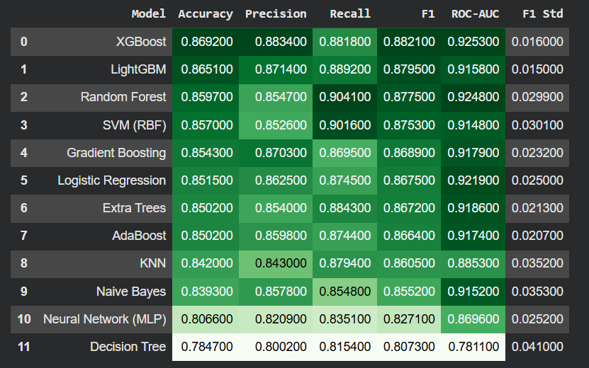

# heart-disease-prediction_ml_project
MACHINE LEARNING END TO END PROJECT 
# ❤️ Heart Disease Prediction — End-to-End Machine Learning Project

Predict whether a patient has heart disease from clinical measurements, using a complete, leak-free ML workflow: data cleaning → EDA → 12 models → hyperparameter tuning → ensembles → explainability → saved model.


---

## 📌 Overview

Heart disease is one of the leading causes of death worldwide. This project builds and compares machine learning classifiers that predict the presence of heart disease from 11 simple clinical features, with a focus on **reliable evaluation** (cross-validation, no data leakage) and **interpretability** (feature importance).

## 📊 Dataset

- **Source:** [Heart Failure Prediction / Heart Disease Dataset (Kaggle)](https://www.kaggle.com/datasets/johnsmith88/heart-disease-dataset)
- **Size:** 918 patients, 11 features + 1 target
- **Target:** `HeartDisease` (1 = heart disease, 0 = healthy)

| Feature | Description |
|---|---|
| Age | Age of the patient (years) |
| Sex | M / F |
| ChestPainType | ASY, NAP, ATA, TA |
| RestingBP | Resting blood pressure (mm Hg) |
| Cholesterol | Serum cholesterol (mg/dl) |
| FastingBS | Fasting blood sugar > 120 mg/dl (1/0) |
| RestingECG | Normal, ST, LVH |
| MaxHR | Maximum heart rate achieved |
| ExerciseAngina | Exercise-induced angina (Y/N) |
| Oldpeak | ST depression induced by exercise |
| ST_Slope | Slope of the peak exercise ST segment (Up, Flat, Down) |

## 🔬 Methodology

1. **Data understanding** — shape, types, duplicates, missing values, class balance.
2. **Data cleaning** — `Cholesterol = 0` and `RestingBP = 0` are physiologically impossible, so they are treated as missing values and imputed (median) inside the pipeline.
3. **EDA** — distributions, categorical vs. target plots, boxplots, correlation heatmap, pairplot.
4. **Preprocessing** — a scikit-learn `Pipeline` + `ColumnTransformer` (imputation, scaling, one-hot encoding) fitted only on training data to **prevent data leakage**.
5. **Model comparison** — 12 models evaluated with stratified 5-fold cross-validation.
6. **Hyperparameter tuning** — `GridSearchCV` / `RandomizedSearchCV` optimizing F1-score.
7. **Ensembles** — Soft Voting and Stacking.
8. **Evaluation** — confusion matrix, ROC curve, precision-recall curve, classification report, learning curve.
9. **Explainability** — permutation feature importance.
10. **Deployment-ready** — the whole pipeline is saved as one `.pkl` file.

### Models used

| Family | Models |
|---|---|
| Linear / probabilistic | Logistic Regression, Naive Bayes |
| Distance / kernel | K-Nearest Neighbors, SVM (RBF) |
| Tree-based | Decision Tree, Random Forest, Extra Trees |
| Boosting | Gradient Boosting, AdaBoost, XGBoost, LightGBM |
| Neural network | MLP Classifier |
| Ensembles | Soft Voting, Stacking |

## 🏆 Results

## 🏆 Results

### Model Comparison

| Model | Accuracy | Precision | Recall | F1 | ROC-AUC |
|-------|---------:|----------:|-------:|---:|--------:|
| XGBoost | **86.92%** | **88.34%** | 88.18% | **88.21%** | **92.53%** |

The complete comparison of all evaluated models is shown below.

<p align="center">
  
</p>

**Key observations**
- 🥇 XGBoost achieved the best overall performance with an F1-score of **88.21%** and ROC-AUC of **92.53%**.
- LightGBM was a close second.
- Tree-based ensemble models consistently outperformed linear models.
- Since heart disease prediction is a medical screening task, **Recall** and **F1-score** were prioritized over accuracy.


**Key predictors:** typically `ST_Slope`, `ChestPainType`, `ExerciseAngina`, `Oldpeak` and `Sex` (see the feature importance chart in the notebook).

> 💡 In medical screening, **recall** matters a lot — missing a sick patient is worse than a false alarm — so F1 and recall are reported alongside accuracy.

## 📁 Project Structure

```
.
├── heart_disease_project.ipynb   # Full notebook (EDA → modeling → saving)
├── heart.csv                     # Dataset (download from Kaggle)
├── heart_disease_model.pkl       # Saved final pipeline (generated)
├── feature_columns.pkl           # Expected input columns (generated)
├── model_comparison_results.csv  # Test-set comparison table (generated)
└── README.md
```

## 🚀 How to Run

```bash
# 1. Clone the repository
git clone https://github.com/<your-username>/<your-repo>.git
cd <your-repo>

# 2. Install dependencies
pip install numpy pandas matplotlib seaborn scikit-learn joblib xgboost lightgbm jupyter

# 3. Place heart.csv in the project folder, then launch
jupyter notebook heart_disease_project.ipynb
```

Or open the notebook directly in **Google Colab** and upload `heart.csv`.

> ⏱️ The full run takes roughly 10 minutes because of hyperparameter tuning and stacking. To speed it up, reduce `n_iter` in the tuning cell.

## 🔮 Using the Saved Model

```python
import joblib
import pandas as pd

model = joblib.load('heart_disease_model.pkl')

patient = pd.DataFrame([{
    'Age': 58, 'Sex': 'M', 'ChestPainType': 'ASY', 'RestingBP': 140,
    'Cholesterol': 260, 'FastingBS': 1, 'RestingECG': 'Normal', 'MaxHR': 115,
    'ExerciseAngina': 'Y', 'Oldpeak': 2.0, 'ST_Slope': 'Flat'
}])

print(model.predict(patient)[0])            # 1 = heart disease, 0 = healthy
print(model.predict_proba(patient)[0, 1])   # probability of heart disease
```

The saved object is a full pipeline, so raw patient data goes in directly — no separate scaler or encoder needed.

## 🛠️ Tech Stack

Python · pandas · NumPy · scikit-learn · XGBoost · LightGBM · Matplotlib · Seaborn · joblib

## 🔭 Future Work

- SHAP explanations for individual predictions
- Probability-threshold tuning to maximize recall
- Streamlit / FastAPI web app for live predictions
- Validation on an external dataset

## ⚠️ Disclaimer

This project is for **educational purposes only** and is not a substitute for professional medical diagnosis or advice.

## 👤 Author

**Your Name** — [GitHub](https://github.com/<your-username>) · [LinkedIn](https://www.linkedin.com/in/<your-profile>)

---

⭐ If you found this project useful, please give it a star!
